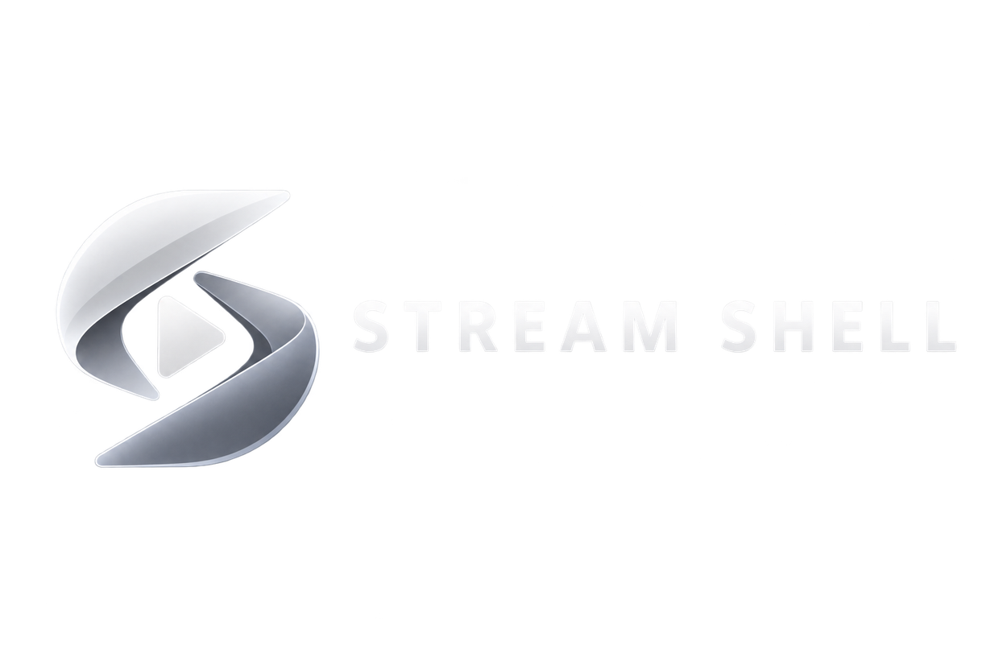

<p align="center">
  
</p>

# Stream Shell

**Stream Shell** is a personal Windows-first streaming workspace built around an unpacked **Opera GX / Chromium Manifest V3 extension**, with optional Windows Native Messaging helpers. It unifies provider windows, media discovery, saved titles, player enhancements and native desktop companions in one interface.

**Current version: 0.22.1** · [Changelog](CHANGELOG.md) · [v0.22.1 release notes](release-notes/RELEASE_NOTES_v0.22.1.md) · [Security](SECURITY.md)

> Primarily developed and tested for one Windows / Opera GX setup. This is an independent project, not a media-hosting service, a streaming-content provider, or an official client of the services it integrates. Some features depend on site layouts, external APIs, or locally installed applications and may stop working when those change.

## Layouts

| Layout | Target | Behavior |
| --- | --- | --- |
| **Wide** | 32:9 ultrawide | Left Landing / media area plus an independently managed right Dashboard, Discord or Twitch workspace. Native windows can occupy the corresponding pane. |
| **Compact** | 16:9 and 16:10 | Single-screen Home and provider windows, with a larger Library/Search region and dynamically spaced provider buttons. Subscriptions are not shown on Compact Home. |

Choose **Auto**, **Wide**, or **Compact** under **General → Display**. Both layouts share the same provider registry, library, search configuration and settings storage. A Windows titlebar host is needed for native titlebar/window-management features.

## Features in 0.22.1

### Provider and window management

- Managed Opera GX windows for **Netflix, Prime Video, Disney+, Crunchyroll and YouTube**.
- Individually configurable provider order and visibility for the Dashboard and native titlebar; up to **seven** Dashboard-pinned providers, with titlebar overflow where needed.
- Optional custom HTTPS providers with local SVG/PNG branding. They do **not** automatically receive built-in provider-specific scripts or extra host permissions.
- Playback and interface adjustments depending on provider: YouTube dislike/like information, Shorts controls, Prime playback/intro adjustments, volume tools, and other optional utilities.
- A separate right-side Twitch workspace in Wide, configurable channel-point/Drop controls, raid handling, Discord desktop-window integration, native titlebar and global close controls.
- Display-specific settings, import/export, diagnostics, and a search within Settings.

### Media library, discovery and external resources

- **Combined Media search:** TMDB and AniList are queried together. Multi-select chips filter **Movies / Series / Anime / Manga / Novels**; changing chips filters loaded results without unnecessary repeated API calls.
- **Library and Watchlist:** saved media, Continue / Recent views, conservative display-only TMDB/AniList title matching, and independently stored source data.
- **FMHY Discovery 2.0:** browse resource categories (including **Gaming**) without entering a title, search within selected areas, filter resource kinds and explore additional matches using **Show more**. Links open externally or are saved to **Direct**. FMHY entries are resource listings, **not** verified playback availability.
- **Mangayomi (optional native companion):** a separately built, explicitly enabled fork can search its installed sources from the Stream Shell search panel, open an exact selected source result, or switch to the desktop app. A normal magnifier click searches; **Shift+left-click copies the title and switches to Mangayomi**. A dedicated **Kill Mangayomi (process)** command under **General → Providers** terminates the *configured* app and child processes rather than merely hiding its window. Native installation and a compatible fork are required for direct source search.
- **Stremio is not integrated** in 0.22.1.

### Seven Seas opt-in

Under **General → Seven Seas** the switch **“I acknowledge the existence of the seven seas”** is **off by default**. Until explicitly enabled, FMHY browsing/network requests and Mangayomi start, lookup and result-opening commands are blocked at runtime rather than simply hidden. The Mangayomi process-termination command remains available for cleanup. Turning the switch off again revokes access to new gated actions. The setting comes with a user-responsibility notice concerning third-party services and sources.

The switch does **not** verify, approve, license or legalize any third-party content. Users choose and are responsible for their own sources and activity. Third-party applications are not included as executable binaries in the extension.

### Anarchy Director

Under **General → Anarchy** are optional Playback, Subtitle and DVD Anarchy plus the **Visual Anarchy Director** (disabled by default). The Director provides:

- **Zoom**, **Deep Fry**, **VHS**, **Color Roulette**, **Gravity** and **Aspect Ratio** visual effects.
- Occasional (60–120 s), Chaotic (20–60 s) and Absolute Anarchy (5–15 s) frequency profiles; intensity, individual effect toggles and optional combined **Boss Fight** events.
- One event scheduler per active player document, no independently spinning timer for every visual effect. Temporary styles and overlays are cleaned up when events end or Anarchy is disabled.

Version **0.22.1** specifically fixes fullscreen VHS and the Zoom/Gravity/Aspect transform conflicts; it does not change the previously tested Mangayomi process-kill implementation.

### Diagnostics and performance blackbox

Dashboard Diagnostics offers session information and exportable reports. With the updated Windows titlebar host, unusually long stalls can also be recorded to **persistent daily JSONL logs**:

`%LOCALAPPDATA%\StreamShell\Logs\performance-YYYY-MM-DD.jsonl`

The performance recorder detects long renderer tasks and timer gaps, delayed background/native heartbeat activity and other coarse stall indicators. It is **not a complete profiler** and cannot always identify the cause of a full system/browser freeze. Log files can contain diagnostic operational details; review exports before sharing them.

## Install / update

**Requirements:** Windows and Opera GX for the primary setup. The extension itself does not require npm packages. Native helpers, the patched Mangayomi build, and some integrations have separate prerequisites.

1. Clone or download the repo; keep the extension root containing `manifest.json` intact.
2. Open `opera://extensions`, enable **Developer mode**, select **Load unpacked**, and choose the extension root.
3. Open Stream Shell; select the preferred display profile and configure Providers/Settings.
4. To install the **Windows titlebar helper**, use `native\install-titlebar-helper.ps1` (or its `.cmd` launcher), then reload the extension. Install it again only when native titlebar C# changes require it.
5. Optional desktop helpers and their instructions live under [`integrations/`](integrations/) and [`native/`](native/). For Mangayomi, follow [`integrations/mangayomi/README.md`](integrations/mangayomi/README.md), compile its host before installation and configure the correct patched executable.
6. If using FMHY or Mangayomi, explicitly enable **General → Seven Seas** after reviewing its notice.

For an **extension-only update**, update the code and reload the unpacked extension under `opera://extensions`. **Do not delete user-maintained background or custom-artwork folders when overwriting files.** Releases deliberately omit those files. A source-only update does not install new native EXEs for you; consult the release notes.

## Personal artwork and custom providers

User-provided assets remain local and should not be committed or overwritten by code updates.

| Purpose | File naming convention |
| --- | --- |
| Built-in provider Wide background | `assets/backgrounds/<provider>_wide.png` |
| Built-in provider Compact background | `assets/backgrounds/<provider>_compact.png` |
| Custom provider Dashboard icon | `assets/providers/custom/custom_<key>_icon.svg` |
| Custom provider wordmark | `assets/providers/custom/custom_<key>_wordmark.svg` |
| Custom provider native titlebar icon | `native/titlebar-icons/custom/custom_<key>.png` |
| Custom provider backgrounds | `assets/backgrounds/custom_<key>_wide.png` / `_compact.png` |

Custom provider URLs must use HTTPS. Native titlebar icon fallback uses local artwork or initials. See the README files in the relevant `assets/providers/custom/` and `native/titlebar-icons/custom/` directories.

## Architecture and development

Stream Shell separates native apps from browser-level functionality. Independent applications remain independently installed; the extension communicates through explicit bridges, native commands or public data interfaces as appropriate. Site-specific playback/DOM work stays in provider adapters.

| Location | Responsibility |
| --- | --- |
| `background/src/` → `background.js` | Window orchestration, provider registry coordination, Native Messaging and MV3 worker |
| `dashboard/src/` → `dashboard/dashboard.js` | Settings, Diagnostics, Wide Dashboard, Compact-related UI logic |
| `landing/src/` → `landing/landing.js` | Library, combined media search, FMHY and Mangayomi search presentation |
| `common/src/` and `providers/` | Provider/player runtime, shared UI helpers, Anarchy and platform-specific DOM behavior |
| `shared/`, `media/` | Registry normalization, metadata APIs and stored library helpers |
| `native/` and `integrations/` | Windows titlebar plus separately installed native/external components |
| `tools/`, `docs/`, `release-notes/` | Quality checks, architecture contracts and historical releases |

Changes to source fragments must be reflected in the generated bundles; see each directory's `SOURCE-README.txt` and build scripts. Before pushing, run:

```powershell
node tools/check-project.mjs
```

Requires **Node 22+ and Python 3**. It validates syntax, asset references, generated bundle parity and the JavaScript regression suite; a green result does **not** replace live Opera GX / Windows / Flutter verification. Native C# changes additionally require the appropriate Windows compile smoke test. See [Project Structure](docs/PROJECT-STRUCTURE.md), [CI Quality](docs/CI-QUALITY.md), [Contributing](CONTRIBUTING.md) and [Security](SECURITY.md).

## Known limitations and roadmap

- Stremio support is **planned**, not shipped.
- The Windows TitlebarNativeHost has been observed remaining active after Opera GX exits; lifecycle cleanup is pending.
- Rare cross-window/Wide freezes remain under investigation. Twitch interaction is a **suspect**, not a confirmed root cause; use the Performance Blackbox when diagnosing.
- Streaming sites, DRM restrictions and external add-ons may change without notice.

## License and attribution

Source-available for non-commercial use under [PolyForm Noncommercial License 1.0.0](LICENSE.md). Copyright © 2026 Sven Rieseler.

Stream Shell is independent of and not endorsed by Netflix, Prime Video/Amazon, Disney+, Crunchyroll, YouTube/Google, Twitch, Discord, TMDB, AniList, FMHY, Mangayomi or other third-party services. Their names, marks and content belong to their respective owners.
